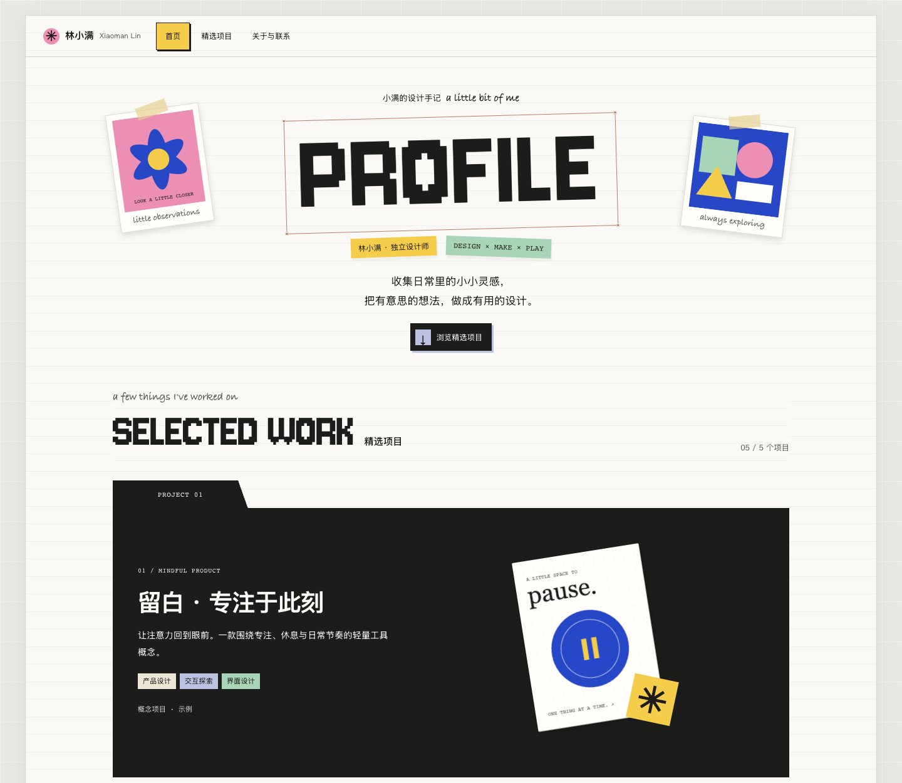

# Paper Tabs · 纸页标签

一本放在网上的设计手记。免费的手账风个人主页模板，换上你的内容，就能展示你的作品。

[在线演示](https://paper-tabs.vercel.app) · [使用这个模板](https://github.com/chingz0509/paper-tabs/generate) · [AI 修改指令](docs/AI-EDITING.md) · [试用与反馈](docs/launch.md)



横线纸、像素标题、胶带小画和彩色文件夹。单页包含个人介绍、项目展示、关于与联系。支持 **1–8 个项目**，默认五个。头像、装饰、封面、履历和社交链接均可选。

**HTML / CSS / JavaScript，没有框架、运行时依赖、账号系统或后端。** 双击 `index.html` 即可预览，个人内容集中在 `content.js`。需要启用 JavaScript；页面不含追踪脚本，示例字体和图片全部本地加载。

## 五步换成自己的主页

1. 点击上面的 **使用这个模板** 创建自己的独立仓库，或从 Code → Download ZIP 下载并解压。
2. 用文本编辑器打开 **`content.js`**，修改姓名、介绍、关于、项目与联系方式。保留字符串的引号，多个项目用逗号分隔。
3. 把自己的图片放进 **`assets/`**，将对应路径填入 `cover`，并用 `coverAlt` 描述图片。所有项目 `url` 填写真实外部链接，例如 `https://example.com/my-project`。
4. 双击 **`index.html`** 预览；改完刷新。同步修改该文件中的 `<title>`、`description` 和 `lang`，让分享预览工具读到你的信息。
5. 按下面的发布步骤上线。完成前检查手机页面、真实链接和示例内容是否全部替换。

不会修改代码？把 [AI 修改指令](docs/AI-EDITING.md) 连同你的资料交给 AI。

## 内容入口

| 要改什么 | 修改位置 |
| --- | --- |
| 姓名、身份、简介、标题 | `content.js` 的 `name`、`role`、`intro`、`headline` |
| 项目、顺序、数量 | `projects` 数组，复制或删除完整项目对象，保留 1–8 个 |
| 关于和经历 | `about`、`experience`，无经历可填 `[]` |
| 邮箱和社交 | `email`、`socials`；无内容分别填 `""`、`[]` |
| 头像 | `avatar`，可填 `"assets/avatar.jpg"` 或留空 |
| 顶部小画 | `decorations`，最多两张，不需要可填 `[]` |
| PDF 作品集 | `resume`，例如 `"assets/portfolio.pdf"`，留空即隐藏 |
| 页面导航和按钮语言 | `labels`；英文页面设置 `lang: "en"` 并翻译各字段 |
| 配色、字体 | `theme.css` |
| 网页署名 | `credit: false` 可隐藏；保留仓库的 MIT 版权声明 |

项目示例：

```js
{
  title: "你的项目标题",
  category: "PRODUCT DESIGN",
  summary: "用一两句话介绍你做了什么。",
  tags: ["交互设计", "视觉设计"],
  color: "blue",
  cover: "assets/my-project.jpg",
  coverAlt: "项目主界面的实际内容描述",
  url: "https://example.com/my-project"
}
```

`color` 可选 `ink`、`yellow`、`blue`、`mint`、`lilac`、`pink`、`cream`。封面建议为横向或方形、长边 1200px 左右，单张尽量小于 500KB。使用 `object-fit: contain` 完整展示图片；`cover: ""` 可移除封面。没有真实项目链接时，留空会显示“概念项目 · 示例”，不会创建假的按钮；个人版本可修改 `labels.concept`。

示例人物林小满及其项目、经历都是虚构的。发布前请换成自己的资料，尤其是页脚、经历、图片和文档元数据。

## 文件夹如何工作

当屏幕能完整容纳每张卡片时，向下滚动会让项目逐张叠放。点击露出的编号可以把对应卡片放到最上层，继续滚动或按 Escape 恢复。标签支持键盘 Tab、左右方向键、Home/End；真正的项目链接在卡片里。

窄屏幕、长内容、矮窗口或系统设置“减少动态效果”时，页面自动使用自然排列，保证每一段文字都可以读完。八个项目在手机上自然排列属于预期行为。

## 发布自己的版本

### GitHub Pages

1. 在你创建的仓库里提交修改后的文件，确保根目录有 `index.html`。
2. 打开 **Settings → Pages**。
3. Source 选 **Deploy from a branch**，分支选 **main**，文件夹选 **/(root)**，保存。
4. 等待 GitHub 完成发布，在 Pages 页面打开它提供的地址。通常形如 `https://你的用户名.github.io/你的仓库名/`。

所有资源使用相对路径，因此支持仓库子目录。仓库包含 `.nojekyll`，无需配置 Jekyll。公开仓库可按 [GitHub 官方说明](https://docs.github.com/en/pages/getting-started-with-github-pages/configuring-a-publishing-source-for-your-github-pages-site)使用 Pages；具体账户限制以官方页面为准。

### Vercel

1. 在 Vercel 新建项目，导入你自己的模板仓库。
2. 使用仓库自带 `vercel.json` 配置：框架 Other，构建命令 `node scripts/export.mjs`，输出目录 `dist`。
3. 点击 Deploy，完成后使用新项目分配的地址。

导出脚本只复制网站所需文件，教程和本地验证资料不进入演示站。网站运行时不需要 Node；此步骤使用托管平台的 Node 环境。配置入口参考 [Vercel 官方说明](https://vercel.com/docs/builds/configure-a-build)。

### 其他静态托管

上传 `index.html`、`content.js`、`app.js`、`theme.css`、`styles.css`、`assets/` 和许可文件，保留目录关系即可。若装有 Node，也可以运行 `node scripts/export.mjs`，直接上传生成的 `dist/`。

## 本地检查与常见问题

- **本地文件预览**：双击 `index.html`；无需 `npm install`。需要服务器时，在目录运行 `python3 -m http.server 4173`，打开 `http://localhost:4173`。
- **检查配置**：若有 Node，运行 `node scripts/check.mjs`，检查项目数量、图片路径、封面描述与 JavaScript 语法。
- **空白或配置提示**：检查 `content.js` 的引号、逗号，以及项目数量是否为 1–8；在浏览器控制台查看具体错误。
- **图片不显示**：路径与大小写必须一致；避免本机绝对路径。网络图片需要服务允许访问。加载失败的可选图片会隐藏。
- **改完没有变化**：刷新或强制刷新浏览器；确认你编辑的是当前打开目录中的文件。
- **分享卡片文字不对**：同步更新 `index.html` 静态元数据；不同平台有各自缓存，本模板未内置社交分享图。
- **想做更大的改造**：先看 [设计约定](docs/design.md)。项目仅维护一套布局，不附带博客、项目详情页、在线编辑器或语言切换器。

## 许可与维护

代码与原创 SVG 插画采用 [MIT](LICENSE)，免费，可修改和商用。网页署名自愿；代码中的版权与许可声明须按 MIT 保留。字体单独遵循 SIL OFL，见 [素材说明](THIRD_PARTY_NOTICES.md)。

作者：Cheng Zhuo / [chingz0509](https://github.com/chingz0509)。低频维护，优先修复模板自身问题，根据真实反馈决定新增功能。AI 深度改造后的版本由使用者自行维护。

欢迎提交 Issue，附上复现步骤、浏览器和屏幕尺寸。也欢迎分享你的版本。我们希望看到至少三位与作者无关的人，不需要作者代改代码就能独立上线。具体反馈问题见 [试用说明](docs/launch.md)。
